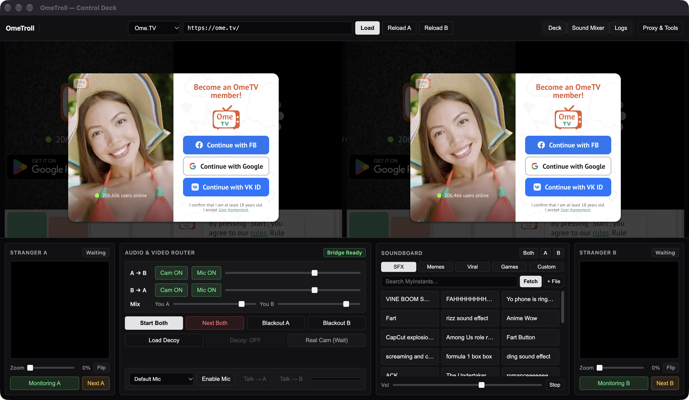

# OmeTroll

> **Note:** This entire project is 100% **vibe coded**!

Electron-based Man-in-the-Middle (MITM) video & audio router with a built-in Admin Control Deck for connecting two random video chat strangers together without any external virtual cameras or virtual audio cables.



## Features

- **Dual Isolated Browser Slots:** Two `WebContentsView` instances (`persist:slot-a` and `persist:slot-b`) with separate cookies, storage, device IDs, and per-slot proxy support (`http://` / `socks5://`).
- **Internal WebRTC & Web Audio Bridge:** Intercepts `getUserMedia`, `enumerateDevices`, and `RTCPeerConnection` inside each slot and routes 16:9 (`1280x720`) video and mixed audio through the Admin Control Deck.
- **Video Controls:** Per-slot Zoom/Crop (`0%–100%`), Horizontal Flip, Blackout, Decoy Face Image injector, and Real Cam (Wait) pass-through.
- **Dedicated Sound Mixer:** 5-channel mixer (`Stranger A`, `Stranger B`, `Admin Mic` with device selector & self-monitor, `Soundboard`, and `Master Bus`) with independent `Route -> A` / `Route -> B` toggles and headphone monitoring.
- **MyInstants Soundboard:** Live scraper for MyInstants categories (`SFX`, `Memes`, `Viral`, `Games`), search, and custom local audio file support (`Custom`).
- **Logs & Telemetry:** Real-time WebRTC bridge state, `getUserMedia` / call counters, and event console.

## Run Locally

```bash
npm install
npm start
```

## Build / Compile

The project uses [`electron-builder`](https://www.electron.build/) to package standalone binaries into the `dist/` directory.

```bash
# Install dependencies (including electron-builder)
npm install

# Build for your current OS
npm run dist

# Or build for a specific platform
npm run dist:mac    # macOS (.dmg, .zip)
npm run dist:win    # Windows (NSIS installer .exe, portable .exe)
npm run dist:linux  # Linux (.AppImage, .deb)

# Unpacked directory only (fast test without installer)
npm run pack
```

## License

Licensed under the [GNU General Public License v3.0](LICENSE).
